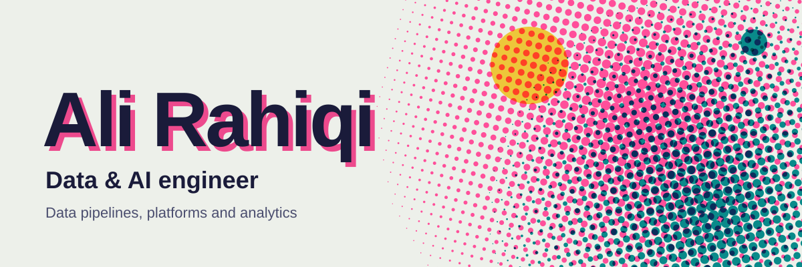
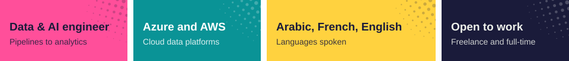
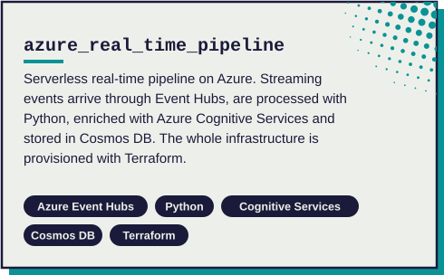
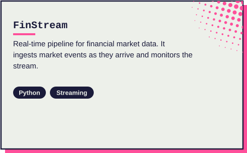
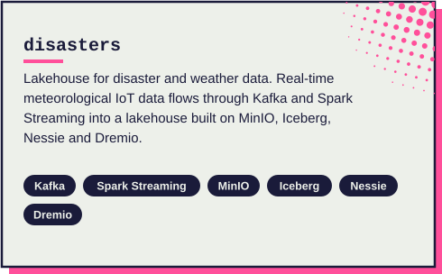
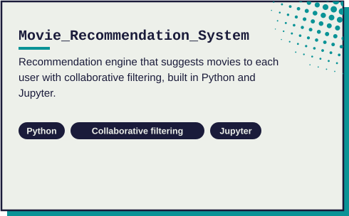

I'm a data and AI engineer. I design how a company's data is collected, moved, stored and made available, so that reports and models run on numbers people can trust.

### What I do

**Data architecture.** I decide how data should flow from source systems to storage and on to the people who use it, based on volume, speed and budget.

**Pipelines.** Batch and real-time pipelines that run on a schedule, are monitored, and can be safely re-run when something fails.

**Data preparation.** Clean, well-modeled data that analysts and machine learning models can use directly.

**Reporting.** Dashboards and reports that business teams open every day.

**Machine learning and GraphRAG.** Models such as recommendation engines, and graph-based retrieval for problems that call for them.

### Projects

### How a project runs

1. **Understand the need.** What decisions the data should support, where it lives today and how fresh it has to be.
2. **Design the architecture.** A simple diagram and a choice of tools that fits the budget and the team.
3. **Build and test.** Pipelines delivered in small steps you can review along the way.
4. **Hand over.** Documentation and a walkthrough so your team can run it without me.

### Freelance and full-time

I'm open to freelance projects and full-time roles. Typical work:

- Designing or rebuilding a data platform and its pipelines
- Moving data from spreadsheets and on-premise databases to the cloud
- Dashboards and reporting
- Machine learning and GraphRAG prototypes

To start, send me a short description of your data and what you need from it. I'll come back with questions and a proposed approach.

### Typical pipeline

| Stage | Tools |
|---|---|
| **Ingest** | Kafka, Azure Event Hubs, Airbyte, Azure Data Factory, Talend |
| **Process** | Spark (PySpark, Spark Streaming), dbt, AWS Glue |
| **Store** | Snowflake, Synapse Analytics, ADLS Gen2, Cosmos DB, PostgreSQL, Redshift, Iceberg |
| **Serve** | Power BI, Streamlit, Superset, Metabase |
| **Orchestrate and secure** | Airflow, Azure Monitor, Key Vault, Purview |

### Toolbox

| Area | Tools |
|---|---|
| **Programming** | Python, SQL |
| **Pipelines** | Spark (PySpark), Spark Streaming, dbt, Airflow, Azure Data Factory, Kafka, AWS Glue, Airbyte, Talend |
| **Databases** | PostgreSQL, Snowflake, Redshift, Cosmos DB, Neo4j, MySQL, SQL Server, MongoDB, Cassandra |
| **Lakehouse** | MinIO, Apache Iceberg, Nessie, Dremio |
| **Azure** | Event Hubs, Cognitive Services, Synapse Analytics, ADLS Gen2, Key Vault, Purview, Monitor |
| **AWS** | S3, DynamoDB, Redshift, Glue |
| **Platforms and IaC** | Microsoft Fabric, Terraform |
| **Containers** | Docker, Kubernetes, Morpheus |
| **ML and GenAI** | Pandas, Scikit-learn, TensorFlow, PyTorch, CNN, MLflow, GraphRAG (Neo4j) |
| **BI** | Power BI (DAX, RLS), Streamlit, Superset, Metabase, Wren AI |
| **Spoken languages** | Arabic, French, English |

### Get in touch

Available for freelance projects and full-time roles.

[LinkedIn](https://www.linkedin.com/in/ali-rahiqi-0a9383292) | [Email](mailto:ali123rahiqi@gmail.com)
